# Enhance VR: Context-Aware Robot with Eye-Selection Control

**MRes Neurotechnology thesis project, Department of Bioengineering, Imperial College London (2020–2022)**

**Author:** Nathaniel Rose · **Supervisors:** Dr Aldo Faisal, Dr Ali Shafti · Brain & Behaviour Lab

A virtual-reality testbed in which a simulated Universal Robots UR10 arm with a Robotiq 2F-140 gripper performs a pick-and-place task that the user triggers purely by looking at the target block. The Unity scene is driven by an SMI eye-tracking HTC Vive headset; motion planning runs in ROS/MoveIt! inside Docker and is bridged to Unity through the Unity Robotics Hub. The system was used to compare three gaze dwell times against a mouse-click control across 330 trials with seven participants.

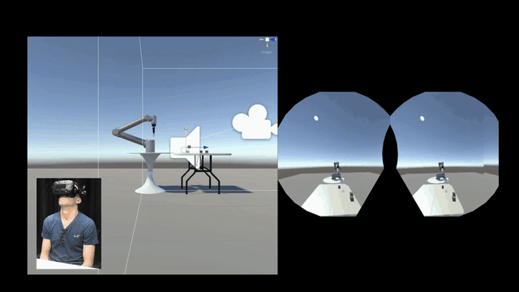

The full thesis is in [`docs/Enhance_VR_Context_Aware_Robot_with_Eye_Selection_MRes_2022.pdf`](docs/Enhance_VR_Context_Aware_Robot_with_Eye_Selection_MRes_2022.pdf). This README is a condensed version of it.

## Contents

- [Experiment videos](#experiment-videos)
- [Abstract](#abstract)
- [Motivation](#motivation)
- [System architecture](#system-architecture)
- [Method](#method)
- [Results](#results)
- [Limitations and future work](#limitations-and-future-work)
- [Repository layout](#repository-layout)
- [Building and running](#building-and-running)
- [Citation](#citation)
- [Key references](#key-references)
- [Licence](#licence)
- [Acknowledgements](#acknowledgements)

## Experiment videos

<video src="https://github.com/NathanielRose/enhanced-vr/raw/main/docs/EnhanceVR_Demo_short.mp4" controls muted width="720"></video>

[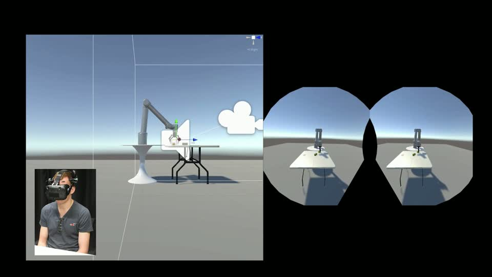](docs/EnhanceVR_Demo_short.mp4)

- **Short demo (15 s, 1080p):** [`docs/EnhanceVR_Demo_short.mp4`](docs/EnhanceVR_Demo_short.mp4). A participant gaze-selects the target block and the UR10 picks and places it, shown from the Unity editor and through the headset's stereo feed.

## Abstract

Robotic control can be leveraged as a substitute for humans with motor disabilities and impairments such as paralysis, paraplegia, limb amputation or ALS to complete a physical task. This human-machine interface, which alleviates the dependency on muscle motor control, has been combined with various other physiological modalities as an input for robotic control. Previous studies target gaze tracking, pupil dilation, electromyography, electroencephalography, and other biometrics as emerging sensory inputs that seek to interface human with machine. Gaze tracking has had varied success in robotic control for tasks due to the difficulty of translating this input into low-level joint control and the unintentional selection and deselection of points of interest. Additionally, this raises risks of robotic damage when interfacing with costly robotic hardware due to the volatility and inconsistency that may come with biometric signals. To address this complex paradigm, we propose a novel system that targets a simulated virtual-reality robot controlled by eye-gaze tracking to complete a pick-and-place task. This system provides a novel test environment for exploring and improving new methods for gaze selection in a virtual human-computer interface.

## Motivation

Assistive robots for people with spinal-cord injury, stroke or neurodegenerative disease need an input channel that does not depend on muscle control. Eye gaze is attractive because it is always available and already encodes intent, but using it as a *command* channel runs into the **Midas touch** problem: the eyes are an analogue, always-on sensor, so simply fixating on an object can trigger an unintended selection. The usual fix, a fixed dwell time before a fixation counts as a "click", trades accidental selections for slower, less natural interaction; extra gestures (blinks, winks, nods) work but break the natural feel of gaze interaction.

Evaluating new gaze-selection strategies on a physical robot is slow and risky: a bad selection or a bad trajectory can damage expensive hardware. This project builds the robot and the task in virtual reality instead, so that selection mechanisms can be iterated safely and measured with the same success markers.

Selection performance is framed by Fitts's law, where the time to acquire a target grows with the distance to it and shrinks with its size:

$$MT = a + b \log_2\left(\frac{D}{W} + 1\right) = a + b \cdot ID$$

**Objectives**

1. Reproduce the gaze-based, context-aware assisted reaching and grasping setup of Shafti, Orlov & Faisal (ICRA 2019) as an open-source Unity + ROS simulation, with the robot picking and placing *on behalf of* the user rather than assisting the user's own arm.
2. Use the simulation to measure how performant dwell-time gaze selection is for triggering a pick-and-place at different target distances.
3. Check how reliably the simulated UR10 and the ROS–Unity bridge execute the task once it has been triggered.

A "head mouse" (a head-steered crosshair) was implemented first so the framework could be developed on headsets without eye tracking; the SMI eye-tracker data was then layered on through the same interface.

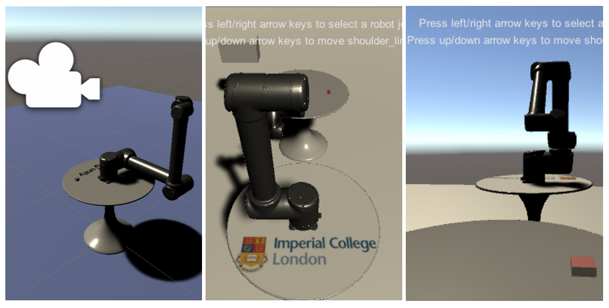

*The first prototype (December 2020): a UR3 imported from URDF into Unity with joint-level keyboard control, before the UR10 and gripper were brought in.*

## System architecture

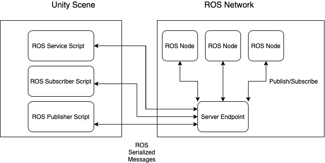

*ROS nodes and the Unity scene exchange serialised ROS messages through the ROS-TCP-Endpoint server node; Unity-side service, subscriber and publisher scripts are generated from the `.msg`/`.srv` files by the Unity Robotics Hub message-generation plugin. Adapted from Unity Technologies, Unity Robotics Hub (2021).*

| Layer | Component | Notes |
|---|---|---|
| Headset | HTC Vive (2016) with integrated SensoMotoric Instruments (SMI) binocular eye tracker | 250 Hz gaze stream, sampled in Unity at 100 Hz; 2160×1200 display; FOV 105.6° vertical × 111.9° horizontal; Unity C# API supplied with the SMI server. Chosen because of the lab's prior use and its accuracy and data-loss figures in Niehorster et al. (2020). |
| Game engine | Unity 2020.3.11f1 with the Unity Robotics Hub | ROS TCP Connector v0.5.0, URDF Importer v0.5.5 (with V-HACD convex decomposition for collision meshes), SteamVR Unity Plugin v2.7.3. Robot joints are PhysX 4 articulation bodies solved with Temporal Gauss-Seidel. |
| Robot model | UR10 + Robotiq 2F-140 gripper | Custom URDF built with the MoveIt! Setup Assistant, with redundant gripper and joint collision links disabled to reduce trajectory-execution artefacts. Base link fixed to the robot table. |
| Motion planning | ROS Melodic + MoveIt! in a Docker image | ros-industrial `universal_robot` meta-package (Felix Exner's fork); catkin tools 0.6.1; custom service files for synchronous request/response between Unity and ROS. Planning-scene objects: a 0.7 × 1.7 × 0.7 m table attached to the UR10 and two walls that constrain the reachable workspace. |
| Bridge | ROS-TCP-Endpoint | Unity publishes block and target poses; ROS returns a MoveIt! Cartesian plan; Unity's articulation engine executes it. |

Unity runs on Windows and ROS on Linux, so the ROS side was packaged into a Docker image to keep the two dependency stacks apart and to make the setup portable between personal and lab machines.

**Articulation-body tuning.** Joint stiffness 10 000, damping 1 000, force limit 1 000, speed 30, torque 100 (Unity units). Each joint drive applies a spring–damper force

$$F = \text{stiffness}\,(x_{\text{target}} - x) + \text{damping}\,(v_{\text{target}} - v)$$

where $x$ and $v$ are the joint's current position and velocity.

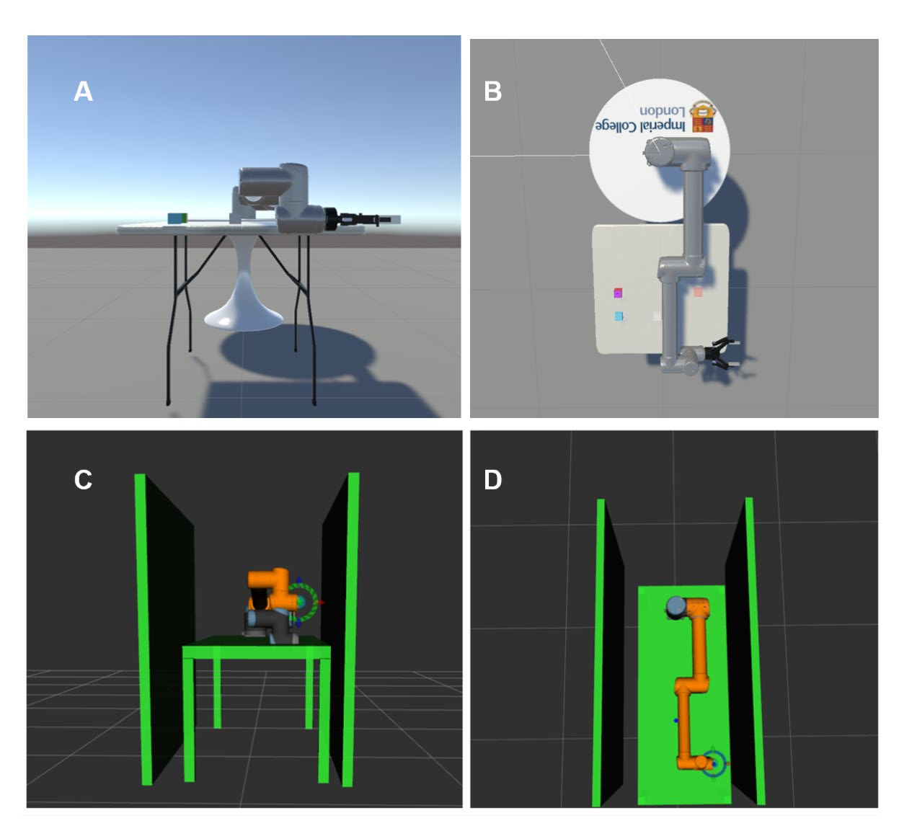

*(A) Participant's camera view of the UR10 in the Unity scene. (B) Aerial view with the robot mounted on its table in the neutral pose. (C) Frontal view in RViz with the planning-scene objects. (D) Aerial view in RViz showing the table and the two constraining walls.*

## Method

### Scene and task

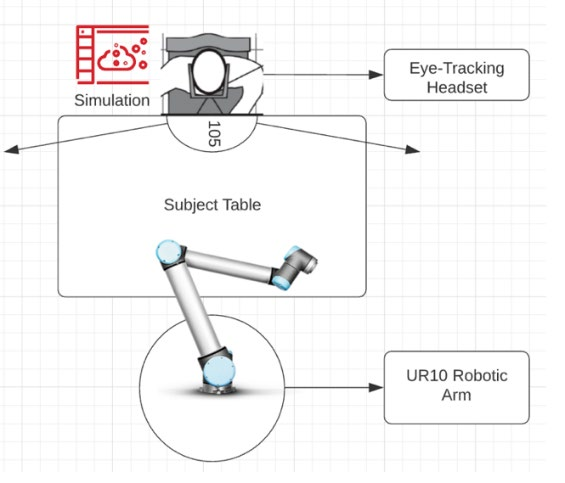

*Participant location relative to the UR10 and the two tables (not to scale). The VR camera sits 1.5 m from the UR10 base; a physical table 35 cm from the chair holds the mouse for the control condition.*

- Three 5 × 5 × 5 cm cubes (1 g each in the engine) spawn on an 80 × 80 cm virtual table. One is the **target** (red, blue and yellow faces); the other two are dark-yellow decoys that clutter the selection area. Any block turns yellow while the participant's gaze is on it, giving visual feedback of the gaze cursor.
- A translucent red 8 × 6 × 2 cm prism marks the **placement goal**; its rigid body is removed so success is measured by block-to-goal distance rather than collision.
- Block size was chosen so that two blocks fit comfortably in the gripper's 14 cm opening and to match the apples and oranges used in the physical context-aware system.
- The 70 × 70 cm spawn area (10 cm inset from the table edges) is divided into four 35 × 35 cm **quadrants**; the target is spawned in a randomly chosen quadrant each trial so that target distance from the headset can be analysed.

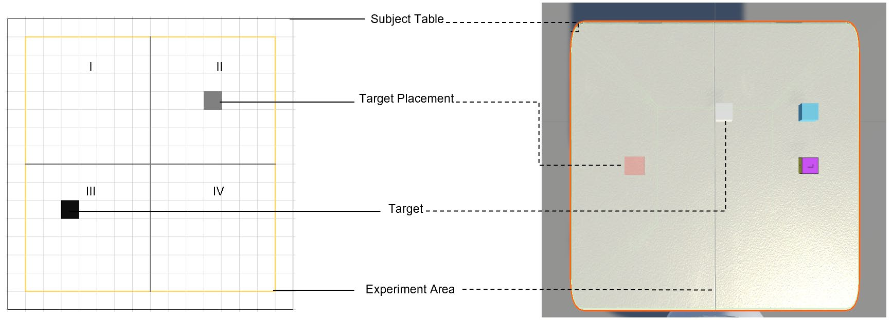

*Left: experiment area with the four quadrants on a grid. Right: aerial render of the table with the three blocks and the placement goal.*

### Protocol

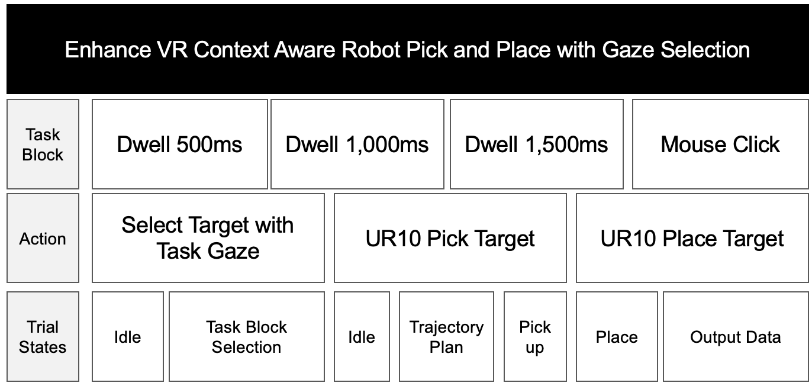

*Four task blocks, each a different selection modality; within a trial the participant selects the target and the UR10 then picks and places it. The trial states are the low-level state machine that advances the trial.*

- **Four task blocks** × **12 trials**: gaze dwell of **0.5 s**, **1.0 s**, **1.5 s**, and a **mouse-click** control (gaze still chooses the block). Participants were told how to select but not the dwell duration; block order was randomised per participant.
- After each block the participant answered three 5-point questions on mental demand, perceived success and effort, based on the NASA Task Load Index.
- Participants stayed seated but could lean and turn to improve their angle on a block; rotational and positional head tracking were enabled with a 60° camera FOV.
- A 5-point SMI calibration (accurate to about 1.5 m in the scene) was run per participant by pressing `4` on the lab machine after the scene and SMI server were up; a central red reticle was used to re-seat the headset each time it was put back on.

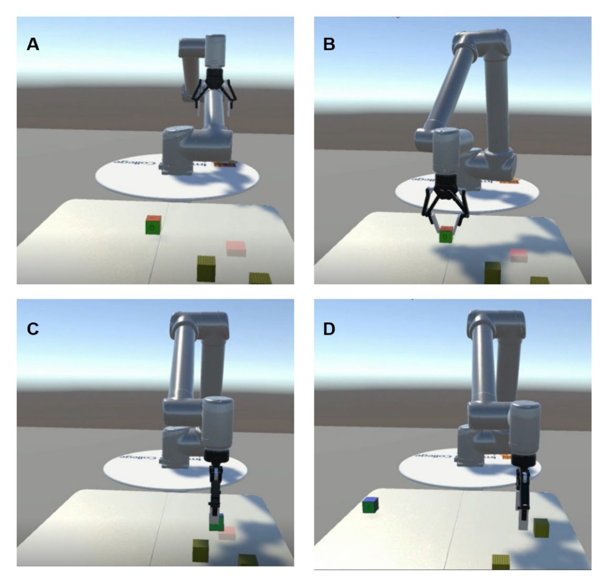

*Observer's view of the participant's eye stream. (A) The target block in Quadrant I highlighted yellow at the moment of a successful gaze selection. (B) The UR10 in the pick-up state. (C) Just before the place state completes. (D) A new trial: the blocks have respawned and the target is no longer highlighted.*

### Data collection

Each trial is appended to a per-participant JSON file (two C# classes are serialised downstream). Alongside trial outcomes the SMI stream is recorded as the camera raycast, gaze direction, gaze base point and the left and right points of regard (POR). Two early test-run files in the first version of this format are in [`data/`](data/), with the pandas notebook used to flatten them.

Two series of experiments were run. The first series was discarded because its methods were inconsistent and it lacked the SMI fixation data. The second series had **seven volunteers** from the Brain & Behaviour Lab (7 male, mean age 28.7, SD 4.05; five wore glasses, removed under the headset), giving **330 trials**.

<details>
<summary><strong>Dataset fields (Table 2 of the thesis)</strong></summary>

| Type | Name | Details |
|---|---|---|
| Timestamp | Experiment Time | Time at start of experiment block |
| Int | Trial Number | Trial number in task block |
| String | Task Type | Gaze task for pick and place |
| String | Subject Name | Participant name |
| Int | Subject Age | Participant age |
| Float | Subject Height (cm) | Participant height |
| String | Selection Type | Gaze selection type |
| Float | Selection Time (s) | Time to invoke the selection of the table object |
| Bool | Selection Success | Whether the target block was selected |
| Float | Total Execution Time (s) | Time to complete pick and place |
| Float | Articulation Execution Time (s) | Time for the UR10 to complete trajectory execution |
| Float | ROS Execution Time (s) | Time for ROS to publish a Cartesian plan |
| Vector3 | Target Position Initial / End | Target block position at trial start / end |
| Float | Target Gaze Time (s) | Total time the subject gazes at the target |
| Float | Target to Placement Initial / End / Delta Distance (m) | Target distance to goal at trial start / end, and the change during the trial |
| Int | Target Quadrant Index | Quadrant the target spawned in |
| Vector3 | Block I Position Initial / End | Decoy I position at trial start / end |
| Float | Block I Gaze Time (s) | Total time the subject gazes at decoy I |
| Float | Block I to Placement Initial / End / Delta Distance (m) | Decoy I distance to goal at start / end, and the change |
| Vector3 | Block II Position Initial / End | Decoy II position at trial start / end |
| Float | Block II Gaze Time (s) | Total time the subject gazes at decoy II |
| Float | Block II to Placement Initial / End / Delta Distance (m) | Decoy II distance to goal at start / end, and the change |
| JSON array | Gaze Points | Array of SMI eye-tracking samples |
| Timestamp | Gaze Points – Gaze Time | Unix timestamp of each SMI sample |
| Vector3 | Gaze Points – Gaze Position | Raycast position of the SMI gaze |
| Vector3 | Gaze Points – Gaze Base Position | SMI gaze base-point vector at the left-eye centre |
| Vector2 | Gaze Points – Gaze Left POR | Left-eye point of regard in the 2D frame |
| Vector2 | Gaze Points – Gaze Right POR | Right-eye point of regard in the 2D frame |
| Float | Gaze Points – Gaze Frequency | Static frequency of the published SMI data (100 Hz) |
| Bool | Selection Failure | Selection time ≤ 0 or the wrong block was selected |
| Bool | HMD Signal Loss | Dropped connectivity between the Vive base station and the headset |

</details>

**Success metrics (Table 3).** Gaze selection is assessed from *Selection Time* and *Selection Success* per *Selection Type*; the robotic arm and the ROS–Unity integration are assessed from *ROS Execution Time*, *Articulation Execution Time* and *Target Placement End Distance*.

**Analysis.** Per-subject JSON was aggregated in a Jupyter notebook with pandas; repeated-measures ANOVA and cleansing in Excel, pandas and scikit-learn; charts in Power BI.

## Results

### Participant assessment

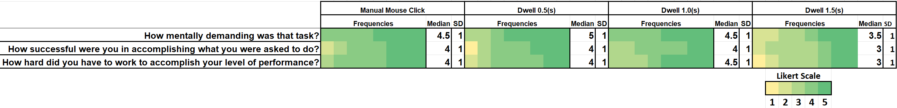

*Density of 5-point task-load responses (mental demand, perceived success, effort) per task block, with median and standard deviation. The 1.5 s dwell block was rated worst on all three.*

### Gaze selection performance

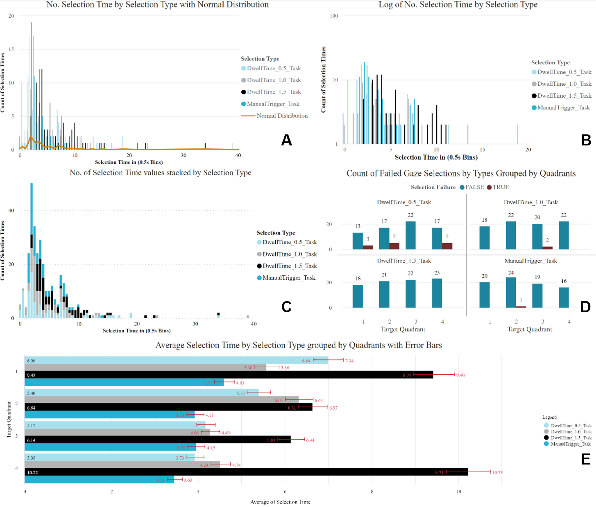

*(a) Selection-time histogram, right-skewed and multimodal; (b) the same on a log scale; (c) selection time grouped by selection type; (d) selection failures per quadrant, small multiples per selection type; (e) mean selection time per selection type and quadrant with error bars.*

- Of 330 trials, **14 (4.2 %)** selected a decoy instead of the target. Counting the 16 trials where the mechanism fired with a 0.00 s selection time, the **0.5 s dwell** block held **13 of the 16 mechanical failures (81 %)**; the **1.5 s dwell** block had none.
- The lowest mean selection times were the **mouse-click control** and the **0.5 s dwell**.
- Quadrants **II and III** had the shortest mean selection times and quadrants II and IV the most failures, which runs against the Fitts's-law expectation that the farther quadrants (I and II) would be slowest.
- The sample is small, so these are descriptive findings rather than a test of the null hypothesis.

### UR10 and ROS–Unity performance

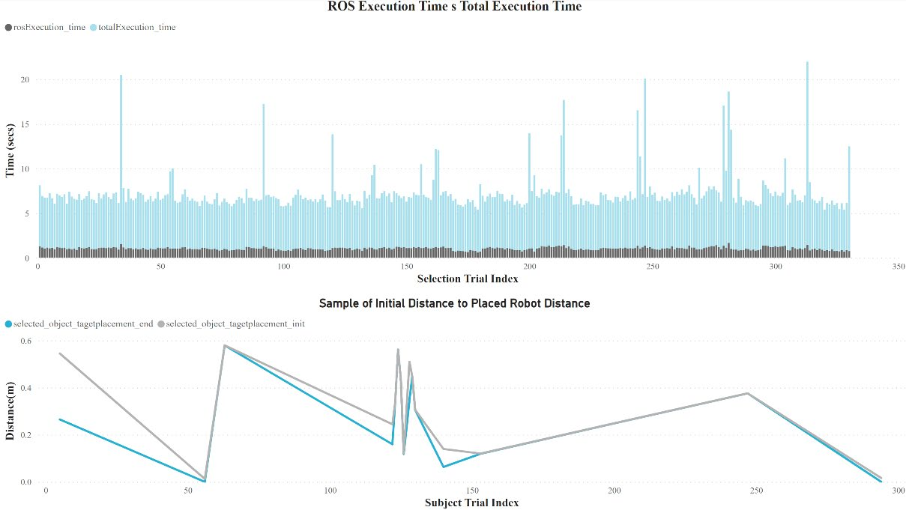

*(a) Time for ROS to return a Cartesian trajectory plan versus time for the virtual UR10 to execute the pick and place. (b) For a sample of 16 trials, the initial and final distance between the selected block and the placement goal.*

- ROS/MoveIt! planning from the Docker image was stable at a mean **2.49 s** per Cartesian plan.
- Median articulation execution for grasp-and-place was **6.23 s**.
- The final block-to-goal distance was unstable: drops, collisions and obtuse poses during execution meant that in several trials the block did not move at all, so the available parameters were not enough to assess UR10 placement accuracy with confidence.

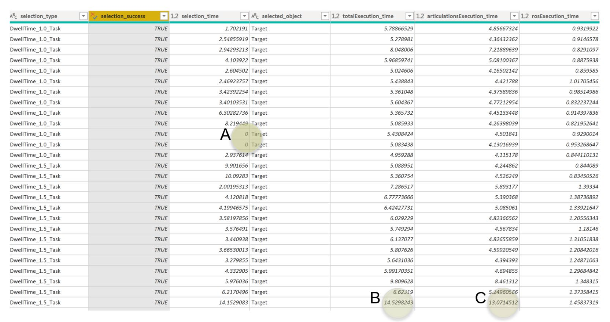

*25 uncleansed rows for one subject. (A) Selection time 0 with success = true, a data-failure artefact. (B) A 14.5 s total execution time, far above the norm. (C) A long articulation-engine execution of the ROS plan; this trial's pick and place failed.*

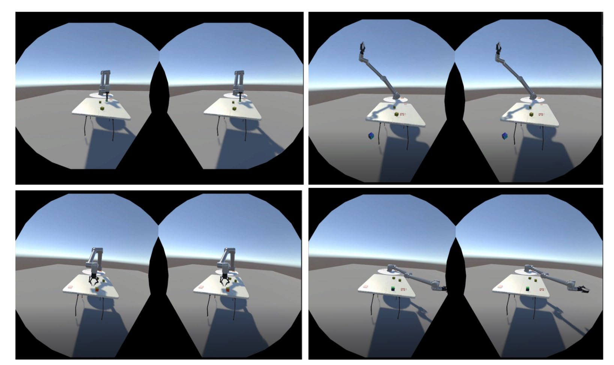

*Top: the UR10 before and during a MoveIt! plan in which it drops the block and collides with the participant's table. Bottom: another trial in which the upper-arm link collides with the table and never reaches the pick pose. Plans were Cartesian MoveIt! plans with the table and walls in the planning scene, yet still collided in Unity.*

## Limitations and future work

Most of the project went into building and stabilising the framework. The combination of the 2016 Vive base stations (headset-connectivity drop-outs inflated some selection times), the then-new ROS–Unity tooling (plans that execute differently in the articulation engine than in MoveIt!) and a trial-logic bug produced noisy data. The bug, introduced during a refactor, caused "phantom selections": if the participant kept fixating on where the cube had been during the pick-and-place state, the UR10 would return to the previous trial after the blocks respawned. Experiments were re-run after the fix with the aim of publishing a cleaner dataset.

Planned improvements:

- detect when the UR10 occludes the line of sight between the participant and the target block;
- remove the Vive idle shutdown when a participant is still for too long or the base station loses the headset;
- tighten trajectory planning so the arm cannot collide with scene objects;
- remove the 0 s-selection trial-logic bug (three trials in the dataset);
- add pose estimation for the Robotiq gripper (deep learning on RGB images) so the block is grasped firmly enough to carry;
- add free-form pick-point-and-place, pouring, navigation and new gaze-selection modalities;
- add EEG (P300) as a second biomarker for confirming intent once gaze fixation has selected a target, as in Reichert & Rieger (2014).

## Repository layout

This repository consolidates the checkouts that survived the project, with their git history (see the `archive/*` branches for the two earlier branch tips). It is the ROS side, the robot model and the Unity scaffolding; see the note at the end of this section about what is missing.

```
enhanced-vr/
├── README.md, LICENSE (MIT), THIRD_PARTY.md, .gitmodules
├── docs/
│   ├── Enhance_VR_Context_Aware_Robot_with_Eye_Selection_MRes_2022.pdf   the thesis
│   ├── EnhanceVR_Demo_short.mp4                                          15 s demo
│   ├── figures/                                                          thesis figures, demo GIF
│   └── reports/PlanningReport_NathanielRose.pdf                          planning report (2020)
├── unity/
│   ├── pick_and_place/            fork of the Unity Robotics Hub pick-and-place tutorial (Dec 2020 – Jan 2021)
│   │   ├── PickAndPlaceProject/   Unity 2020.2.0b9 project: UR10 URDF import, SelectionManager, CameraScript
│   │   ├── ROS/src/               niryo_moveit, ur_msgs, niryo_one_urdf + submodules (moveit_msgs, ros_tcp_endpoint, niryo_one_ros)
│   │   ├── Scripts/               SourceDestinationPublisher.cs, TrajectoryPlanner.cs (tutorial scripts)
│   │   ├── docker/                Dockerfile for the ROS Melodic + MoveIt image
│   │   └── LICENSE, Third Party Notices.md, UNITY_ROBOTICS_HUB_README.md (Unity's, kept)
│   └── ur10_robotiq_gripper/      UR10 + Robotiq 2F-140 URDF and meshes, UR10TrajectoryPlanner.cs (May – Sep 2021)
├── ros/catkin_ws/
│   ├── src/
│   │   ├── ur10_moveit/           MoveIt config + ur10_mover.py service + TCP endpoint for the UR10 (Apr 2021)
│   │   ├── ur3_moveit/, niryo_moveit/, robotics_demo/   earlier variants
│   │   └── universal_robot/, ROS-TCP-Endpoint/, moveit_msgs/   submodules
│   └── overlay/universal_robot/   first UR10 bridge files, originally written inside the universal_robot clone
└── data/
    ├── trials.json, trials2.json  July 2021 test runs (subject "Admin-Nate")
    └── Enhanced_VR.ipynb          pandas notebook that flattens them
```

**What is not here.** The final experiment build (the Unity 2020.3.11f1 scene with the SteamVR and SMI integration, the dwell-time task blocks, quadrant spawning and the `ExperimentDataManager` that wrote the 40-field JSON described above) lived on the lab machine and was not among the checkouts that were recovered. `unity/ur10_robotiq_gripper/UR10TrajectoryPlanner.cs` is the latest Unity-side code that survived; it references `ExperimentDataManager` and shows how the experiment scene drove the robot. The participant profile sheet and the raw per-participant trial files are deliberately not published.

## Building and running

What follows reproduces the ROS side and the Unity scaffolding that are in this repository. Running the full gaze experiment additionally needs the SteamVR plugin, the SMI HTC Vive headset and its Unity SDK, and the missing experiment scene.

### Prerequisites

- Ubuntu 18.04 with ROS Melodic, MoveIt and `python-catkin-tools`, or Docker.
- Unity 2020.2.0b9 for the checked-in project (the thesis build used 2020.3.11f1). The project pulls `com.unity.robotics.urdf-importer` v0.1.2 and `com.unity.robotics.ros-tcp-connector` v0.1.2 from GitHub through `Packages/manifest.json`.
- Both machines on the same network; the ROS side listens on TCP port 10000 and Unity on 5005.

```bash
git clone --recurse-submodules https://github.com/NathanielRose/enhanced-vr.git
```

### ROS side, option A: catkin workspace

```bash
cd enhanced-vr/ros/catkin_ws
rosdep install --from-paths src --ignore-src -r -y
catkin build ur10_moveit
source devel/setup.bash
# set ROS_IP (this machine) and UNITY_IP (the Unity machine)
$EDITOR src/ur10_moveit/config/params.yaml
roslaunch ur10_moveit part_3.launch
```

`part_3.launch` loads `config/params.yaml`, starts MoveIt with fake controllers and RViz (`demo.launch`), the TCP endpoint (`ur10_server_endpoint.py`, which exposes the `ur10_moveit` service, the `SourceDestination` topic and the `UR10Trajectory` subscriber) and `ur10_mover.py`, which answers each `UR10MoverService` request with a Cartesian MoveIt plan for pre-grasp, grasp, pick-up and place poses.

### ROS side, option B: Docker image

The image in `unity/pick_and_place/docker/` is the Niryo One tutorial image (ROS Melodic, MoveIt, `ros_tcp_endpoint`) the project started from:

```bash
cd enhanced-vr/unity/pick_and_place
docker build -t enhancedvr-ros -f docker/Dockerfile .
docker run -it --rm -p 10000:10000 -p 5005:5005 enhancedvr-ros /bin/bash
# inside the container
roslaunch niryo_moveit part_3.launch
```

Add the `ur10_moveit` package and the `universal_robot` submodule to the `COPY` lines in the Dockerfile to build the UR10 variant into the image.

### Unity side

1. Open `unity/pick_and_place/PickAndPlaceProject` in Unity. In *Project Settings → Physics* set the solver type to **Temporal Gauss-Seidel**, as the articulation bodies require.
2. Import the robot: *Assets → Import Robot from URDF* on `unity/ur10_robotiq_gripper/ur3_with_gripper/ur10_with_gripper.urdf` (the UR10-only URDF is already under `Assets/URDF/UR10`). Use V-HACD mesh decomposition for the collision meshes and mount the base link as immovable.
3. Generate the C# message classes from `ros/catkin_ws/src/ur10_moveit/msg` and `srv` with *Robotics → Generate ROS Messages*.
4. Add `unity/ur10_robotiq_gripper/UR10TrajectoryPlanner.cs` to the scene's planner object, assign the UR10, target and target-placement objects, and set the `ROSConnection` prefab to the ROS machine's IP and port 10000.
5. Press Play. Clicking (or, in the experiment build, dwelling on) a block publishes its pose, ROS returns a trajectory and the articulation bodies execute it. The articulation-body drive values used in the thesis are stiffness 10 000, damping 1 000, force limit 1 000, speed 30 and torque 100.

### Data

```bash
cd enhanced-vr/data
jupyter notebook Enhanced_VR.ipynb    # pandas flattening of the trial JSON
```

## Citation

```bibtex
@mastersthesis{rose2022enhancevr,
  author  = {Rose, Nathaniel},
  title   = {Enhance Virtual Reality Context Aware Robot with Eye-Selection Control},
  school  = {Imperial College London, Department of Bioengineering},
  year    = {2022},
  month   = {March},
  type    = {MRes thesis (Neurotechnology)},
  note    = {Supervised by Aldo Faisal and Ali Shafti, Brain and Behaviour Lab}
}
```

## Key references

The thesis cites 42 works; the full list is in the PDF. The ones the design leans on most:

- A. Shafti, P. Orlov, A. A. Faisal. *Gaze-based, Context-aware Robotic System for Assisted Reaching and Grasping.* ICRA 2019. doi:10.1109/ICRA.2019.8793804
- B. Noronha, S. Dziemian, G. A. Zito, C. Konnaris, A. A. Faisal. *"Wink to grasp": comparing eye, voice & EMG gesture control of grasp with soft-robotic gloves.* ICORR 2017. doi:10.1109/ICORR.2017.8009387
- N. Sim, C. Gavriel, W. W. Abbott, A. A. Faisal. *The head mouse: head gaze estimation "in-the-wild" with low-cost inertial sensors for BMI use.* NER 2013. doi:10.1109/NER.2013.6696039
- R. J. K. Jacob. *Eye movement-based human-computer interaction techniques: toward non-command interfaces.* 1993.
- Y. Y. Qian, R. J. Teather. *The eyes don't have it: an empirical comparison of head-based and eye-based selection in virtual reality.* SUI 2017. doi:10.1145/3131277.3132182
- P. Mohan, W. B. Goh, C. Fu, S. Yeung. *DualGaze: addressing the Midas touch problem in gaze-mediated VR interaction.* ISMAR-Adjunct 2018. doi:10.1109/ISMAR-Adjunct.2018.00039
- H. Istance, R. Bates, A. Hyrskykari, S. Vickers. *Snap clutch, a moded approach to solving the Midas touch problem.* ETRA 2008.
- Y. Paulus, G. Remijn. *Usability of various dwell times for eye-gaze-based object selection with eye tracking.* Displays 67, 2021. doi:10.1016/j.displa.2021.101997
- P. Majaranta, U. Ahola, O. Špakov. *Fast gaze typing with an adjustable dwell time.* CHI 2009.
- T. Piumsomboon, G. Lee, R. W. Lindeman, M. Billinghurst. *Exploring natural eye-gaze-based interaction for immersive virtual reality.* 3DUI 2017. doi:10.1109/3DUI.2017.7893315
- D. C. Niehorster, T. Santini, R. S. Hessels et al. *The impact of slippage on the data quality of head-worn eye trackers.* Behav Res 52, 2020. doi:10.3758/s13428-019-01307-0
- A. Hussein, F. García, C. Olaverri-Monreal. *ROS and Unity based framework for intelligent vehicles control and simulation.* ICVES 2018. doi:10.1109/ICVES.2018.8519522
- S. G. Hart. *NASA-Task Load Index (NASA-TLX); 20 years later.* HFES 2006.
- C. Reichert, J. Rieger et al. *Robotic grasp initiation by gaze independent brain-controlled selection of virtual reality objects.* 2015. doi:10.13140/RG.2.1.2664.5923
- S. Chiang. *Learning purposive gaze-action semantic representations in a virtual building task.* MSc thesis, Imperial College London, 2019.
- Unity Technologies. *Unity Robotics Hub.* https://github.com/Unity-Technologies/Unity-Robotics-Hub
- Gaze Intelligence. *SMI Eye Tracking HMD HTC manual.* 2016.

## Licence

Nathaniel Rose's code and documents in this repository are released under the [MIT License](LICENSE). `unity/pick_and_place` is derived from the Unity Robotics Hub and keeps Unity's Apache-2.0 `LICENSE` and `Third Party Notices.md`; the UR and Robotiq robot descriptions are BSD-licensed ros-industrial packages. [`THIRD_PARTY.md`](THIRD_PARTY.md) lists every dependency with its pinned revision and licence.

## Acknowledgements

Thanks to Dr Aldo Faisal for the opportunity to do this work at the Imperial College London Brain and Behaviour Lab and for his flexibility during an unusual time; to Dr Ali Shafti for his support and guidance throughout; to Chai Auepanwiriyakul, whose patience and optimism helped get the final system working; and to the Neurotechnology department, lab colleagues, peers and family in the UK who made this hybrid learning journey better.

## Ethics

The experiment involved adult Imperial College London students recruited by convenience, who gave signed consent. Recorded observations were converted to anonymised data points; videos of the sessions were taken for later presentations. The thesis PDF contains the full ethics checklist.
